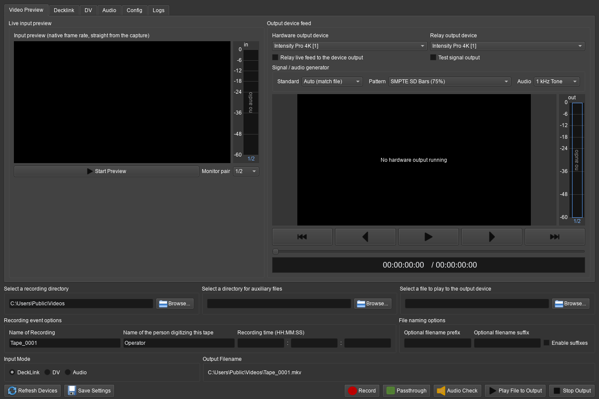

  

<h1 align="center">Vrecord</h1>

  Open-source video capture for audiovisual archivists: analog and digital tape to preservation-quality files.

  
  
  
  
  

  <a href="https://github.com/harrypm/vrecord/releases"><b>Download</b></a> ·
  <a href="Resources/Documentation/installation_and_setup.md">Install and use</a> ·
  <a href="Resources/Documentation/settings.md">Settings</a> ·
  <a href="Resources/Documentation/troubleshooting.md">Troubleshooting</a> ·
  <a href="BUILD.md">Building</a>

  

---

## Summary

Vrecord is open-source software for capturing a video signal and turning it into a digital file. Its purpose is to make videotape digitization or transfer easier. Vrecord can capture analog and digital signals through a variety of inputs and can create digital video files in a variety of formats and codecs. Vrecord has been designed with the needs of audiovisual archivists in mind.

Vrecord uses MediaArea’s [ffmpeg-ma](https://github.com/MediaArea/homebrew-mediaarea/blob/master/ffmpeg-ma.rb) to do its dirty work. Other dependencies are: cowsay, [decklinksdk](https://github.com/amiaopensource/homebrew-amiaos/blob/master/decklinksdk.rb), [gtkdialog](https://github.com/amiaopensource/homebrew-amiaos/blob/master/gtkdialog.rb), freetype, sdl, and xmlstarlet. Optional dependencies are: deckcontrol, gnuplot, mediaconch, mkvtoolnix, and mpv.

Vrecord supports **Windows, macOS and Linux** with Blackmagic Design capture cards (Blackmagic Desktop Video driver installed), and AVFoundation for DV capture on macOS. Some notes on [needed hardware](Resources/Documentation/hardware.md) are provided.

If you want to see a more detailed description of how to digitize analog videotape, see our document on [analog digitization](Resources/Documentation/analog_digitization.md).

## Download

Each version comes as two releases on the [releases page](https://github.com/harrypm/vrecord/releases): one per interface. Every release lists `SHA256SUMS.txt` for checking the files.

| Release | For | Files |
|---|---|---|
| **Vrecord - Windows (Qt6)**, tag `qt6-v<version>` | Windows 10 / 11, the full Vrecord GUI | Installer `vrecord-qt6_<version>_windows_x86_64_setup.exe`, or portable `vrecord-qt6_<version>_windows_x86_64_portable.zip` |
| **Vrecord - GTK**, tag `gtk-v<version>` | The classic GTK interface on Windows, Linux and macOS | `vrecord-gtk_<version>_windows_x86_64_portable.zip`, `..._linux_amd64.deb`, `..._linux_x86_64.AppImage`, `..._macos_<arch>.dmg` (Apple silicon, Intel or universal) |

On macOS and Linux, Vrecord can also be installed with Homebrew from the AMIA Open Source tap. See [Installing vrecord](Resources/Documentation/installation_and_setup.md#installing-vrecord) and [Installing on Linux](Resources/Documentation/linux_installation.md).

### Windows

- **Requirements**:
  - Blackmagic **Desktop Video** drivers.
  - **Git for Windows** or **MSYS2** (`C:\msys64`), which provide the bash that runs the capture script.
- **Install**:
  - The Qt6 installer is per user and needs no administrator rights. It installs into `%LOCALAPPDATA%\Programs\vrecord`, with Start Menu shortcuts.
  - Either portable zip runs from any folder.
- **Run**: `Vrecord.exe`. In the Qt6 package, Vrecord opens on Video Preview: live input preview, file playout to the card's output, level meters, a test signal generator, and Record / Passthrough / Audio Check.
- **Updates** (Qt6): set in *Config → Updates* (off, notify, or install when Vrecord closes). Only published Qt6 releases are offered, and every download is checked against `SHA256SUMS.txt`.

### Building from source

See [BUILD.md](BUILD.md): Windows, Linux and macOS builds, the tests, CI, and how releases are made.

## Documentation

These guides were written for the GTK interface. Most of the settings apply to the Windows Qt6 GUI as well.

1. [Installation and Basic Use](Resources/Documentation/installation_and_setup.md)
    1. [Installing vrecord](Resources/Documentation/installation_and_setup.md#installing-vrecord)
    1. [Installing on Linux](Resources/Documentation/linux_installation.md)
    1. [Using vrecord](Resources/Documentation/installation_and_setup.md#using-vrecord)
        1. [Setting Up vrecord for the First Time](Resources/Documentation/installation_and_setup.md#setting-up-vrecord-for-the-first-time)
        1. [Basic Usage](Resources/Documentation/installation_and_setup.md#basic-usage)
        1. [Ending a Capture](Resources/Documentation/installation_and_setup.md#ending-a-capture)
1. [The vrecord Window](Resources/Documentation/vrecord_window.md)
1. [Passthrough](Resources/Documentation/passthrough.md)
    1. [Passthrough Mode](Resources/Documentation/passthrough.md#passthrough-mode)
    1. [Audio Passthrough Mode](Resources/Documentation/passthrough.md#audio-passthrough-mode)
1. [Editing Settings](Resources/Documentation/settings.md)
    1. [Options for Video Capture](Resources/Documentation/settings.md#options-for-video-capture)
    1. [Video Capture Views](Resources/Documentation/settings.md#video-views)
    1. [Clearing the Configuration File](Resources/Documentation/settings.md#clearing-the-configuration-file)
1. [DV Capture](Resources/Documentation/dv_info.md)
1. [Audio Capture](Resources/Documentation/audio_info.md)
1. [Analog Digitization Tips](Resources/Documentation/analog_digitization.md)
1. [Benchmarking](Resources/Documentation/benchmarking.md)
1. [Help and Troubleshooting](Resources/Documentation/troubleshooting.md)
    1. [Testing Your Equipment](Resources/Documentation/troubleshooting.md#testing-your-equipment)
    1. [Known Issues](Resources/Documentation/troubleshooting.md#known-issues)
        1. [Timing of Recording](Resources/Documentation/troubleshooting.md#timing-of-recording)
        1. [FFmpeg Error Message](Resources/Documentation/troubleshooting.md#ffmpeg-error-message)
    1. [Common Questions](Resources/Documentation/troubleshooting.md#common-questions)
    1. [Other Issues](Resources/Documentation/troubleshooting.md#other-issues)

## Contributing

We want vrecord to be a helpful tool for audiovisual archivists and others. Anyone can contribute to vrecord! If you experience any problems with vrecord you can open a new issue with our GitHub [issue tracker](https://github.com/amiaopensource/vrecord/issues). Issues specific to the Windows port or these packages go to [this repository's tracker](https://github.com/harrypm/vrecord/issues). Try to see if you can replicate the issue yourself first and describe in detail what factors led to it. Please let us know if you were able to successfully replicate the issue.

For more tips on using GitHub and contributing directly to vrecord, please see our [Contribution Guide](CONTRIBUTING.md), but feel free to contribute to vrecord by creating a fork and sending pull requests.

Enjoy!

The vrecord Team

## License

 Vrecord is licensed under a <a rel="license" href="https://creativecommons.org/licenses/by/4.0/">Creative Commons Attribution 4.0 International License</a>.

## Maintainers

The vrecord maintainers are:

- Dave Rice (@dericed)
- Ben Turkus (@bturkus)
- Annie Schwiekert (@aeschweik)
- Andrew Weaver (@privatezero)

Windows port, Qt6 GUI and cross-platform packages: Harry Munday (@harrypm)
